<div align="center">

<picture><source media="(prefers-color-scheme: dark)" srcset="./docs/title-dark.svg"></picture>

<picture><source media="(prefers-color-scheme: dark)" srcset="./public/scenes/fox/dark/land.svg"></picture>

**[umutbayraktar.vercel.app](https://umutbayraktar.vercel.app)**

</div>

A personal site where everything is drawn: the frames, the underlines, the land under your name and the animal that lives on it. The pictures draw themselves in as the page opens, then keep moving a little, and the visitor chooses which of seven worlds to see it in.

It is the site of [Umut Bayraktar](https://github.com/umutxyp), and it is yours to take: change one file and it is about you.

## Seven worlds

The theme picker in the header changes the whole site: colours, the scene, what grows on the cards, the animal asleep on the studio's frame. Each world has a day and a night. A link can carry one too: [`?theme=owl&mode=dark`](https://umutbayraktar.vercel.app/?theme=owl&mode=dark).

| | |
|:---:|:---:|
| <picture><source media="(prefers-color-scheme: dark)" srcset="./public/scenes/fox/dark/land.svg"></picture><br>**Fox by the sea** (the default) | <picture><source media="(prefers-color-scheme: dark)" srcset="./public/scenes/cat/dark/land.svg"></picture><br>**Cat in the ivy** |
| <picture><source media="(prefers-color-scheme: dark)" srcset="./public/scenes/lion/dark/land.svg"></picture><br>**Lion on the savanna** | <picture><source media="(prefers-color-scheme: dark)" srcset="./public/scenes/owl/dark/land.svg"></picture><br>**Owl at night** |
| <picture><source media="(prefers-color-scheme: dark)" srcset="./public/scenes/bear/dark/land.svg"></picture><br>**Bear in the forest** | <picture><source media="(prefers-color-scheme: dark)" srcset="./public/scenes/penguin/dark/land.svg"></picture><br>**Penguin in the snow** |
| <picture><source media="(prefers-color-scheme: dark)" srcset="./public/scenes/tortoise/dark/land.svg"></picture><br>**Tortoise in the desert** | |

## What is in it

- **Home**: your name over the land, your links, a short note, live numbers, your studio and its products, your stack, your pinned repositories.
- **About**: the longer story, where you have worked, what you work with, where you studied.
- **Work**: a page for each project, written in Markdown, with a cover that is a live screenshot of the project's own site.
- **Gallery**: those screenshots together.
- **Open source**: your repositories, read from GitHub, the pinned ones first.

And under it:

- **Numbers that keep themselves current.** Text refers to a figure as a token (`%beatra.users%`) and the site fills it in from its source once a day.
- **Screenshots that keep themselves current.** Each cover is taken again every week.
- **No layout that breaks.** The name and the pictures never share a place, so nothing runs into the writing, from a 320px phone to a 2560px screen, at any zoom.
- **Fast and quiet.** Static pages, no client-side framework beyond Next.js itself, no tracking. Reduced motion is respected: the pictures appear finished.

## Run it

```bash
git clone https://github.com/umutxyp/Personal-Website.git
cd Personal-Website
npm install
npm run dev        # http://localhost:3000
```

`npm run build` builds it, `npm start` serves the build. It needs Node 20 or later.

## Make it yours

| To change | Edit |
|:---|:---|
| Your name, links, the note, the stack, where you worked | [`src/resources/site-data.ts`](src/resources/site-data.ts) |
| A project's page | one `.mdx` file in [`src/app/work/projects`](src/app/work/projects) |
| Where the numbers come from | [`src/lib/live-stats.ts`](src/lib/live-stats.ts) |
| The colours of a theme, or a new theme | `THEMES` in [`scripts/draw.py`](scripts/draw.py) |
| Which theme is the default | `DEFAULT_THEME` in [`scripts/draw.py`](scripts/draw.py) |
| Your logo | `public/logo.svg` and `src/app/icon.svg` |

### A project page

```mdx
---
title: "Project name"
publishedAt: "2026-01-15"
order: 3                       # its place in the list, lowest first
summary: "One sentence. Numbers can be tokens: %project.users% users."
images:
  - "/images/projects/cover.jpg"   # shown if the live screenshot cannot be taken
link: "https://example.com"        # the site that is screenshotted
---

## A heading

Markdown from here on.
```

### The drawings

Every picture is an SVG written by [`scripts/draw.py`](scripts/draw.py), a single Python file with nothing to install:

```bash
npm run draw       # python3 scripts/draw.py
```

It draws each theme's pictures twice, in dark ink for the day and pale ink for the night, into `public/scenes/<theme>/<mode>/`, and writes each theme's colours to `src/app/themes.css`, so the pictures and the page always agree. A theme is a palette, a land (`land_fox`, `land_cat`, …) and an animal; add an entry to `THEMES`, a function for each, and it appears in the picker.

The frames around the cards are drawn in the browser instead ([`Frame.tsx`](src/components/Frame.tsx)): each measures its box and draws a line around it by hand, a little differently every time.

## How it is built

```
src/
  app/              the pages (Next.js App Router), globals.css, themes.css
    work/projects/  one .mdx file per project
    screenshots/    the route that photographs each project's site
  components/       Frame, Pic, ThemePicker, Header, Footer, …
  lib/              live numbers, GitHub
  resources/        site-data.ts: everything the site says about you
public/scenes/      the drawings, per theme and mode
scripts/draw.py     what draws them
```

Next.js 16, React 19, TypeScript, plain CSS. The lettering is [Gochi Hand](https://fonts.google.com/specimen/Gochi+Hand) and [Shantell Sans](https://fonts.google.com/specimen/Shantell+Sans), both under the SIL Open Font License.

## Put it online

Import the repository on [Vercel](https://vercel.com/new) and deploy; it needs no settings. Set `baseURL` in `site-data.ts` to your address afterwards.

## License

[MIT](LICENSE). Take it, change it, put your own name over the sea.
