<div align="center">

<picture><source media="(prefers-color-scheme: dark)" srcset="./docs/title-dark.svg"></picture>

<picture><source media="(prefers-color-scheme: dark)" srcset="./public/scenes/fox/dark/world-0.svg"></picture>

**[umutbayraktar.vercel.app](https://umutbayraktar.vercel.app)**

</div>

A personal site that lives in a painted world. Under your name lies a whole landscape, built far to near: sky and light, distant land, mist, the middle ground, a real animal standing in it, grass moving in front. The visitor chooses which of seven worlds to see it in, by day or by night, and every page shows that world from its own spot.

It is the site of [Umut Bayraktar](https://github.com/umutxyp), and it is yours to take: change one file and it is about you.

## Seven worlds

The theme picker in the header changes the whole site: the colours, the world under every title, what grows on the cards, the animal on the studio's frame, the land the footer stands on, and what comes off the writing (bubbles by the sea, petals in the garden, dust on the savanna, fireflies at night, leaves in the forest, snow on the ice, sand in the desert). Each world has a day and a night. A link can carry one too: [`?theme=owl&mode=dark`](https://umutbayraktar.vercel.app/?theme=owl&mode=dark).

| | |
|:---:|:---:|
| <picture><source media="(prefers-color-scheme: dark)" srcset="./public/scenes/fox/dark/world-0.svg"></picture><br>**Fox by the sea** (the default) | <picture><source media="(prefers-color-scheme: dark)" srcset="./public/scenes/cat/dark/world-0.svg"></picture><br>**Cat in the ivy** |
| <picture><source media="(prefers-color-scheme: dark)" srcset="./public/scenes/lion/dark/world-0.svg"></picture><br>**Lion on the savanna** | <picture><source media="(prefers-color-scheme: dark)" srcset="./public/scenes/owl/dark/world-0.svg"></picture><br>**Owl at night** |
| <picture><source media="(prefers-color-scheme: dark)" srcset="./public/scenes/bear/dark/world-0.svg"></picture><br>**Bear in the forest** | <picture><source media="(prefers-color-scheme: dark)" srcset="./public/scenes/penguin/dark/world-0.svg"></picture><br>**Penguin in the snow** |
| <picture><source media="(prefers-color-scheme: dark)" srcset="./public/scenes/tortoise/dark/world-0.svg"></picture><br>**Tortoise in the desert** |  |

## What is in it

- **Home**: your name over the land, your links, a short note, live numbers, your studio and its products, your stack, your pinned repositories.
- **About**: the longer story, where you have worked, what you work with, where you studied.
- **Work**: a page for each project, written in Markdown, with a cover that is a live screenshot of the project's own site, and the world with something of that project standing in it: a gramophone for the music bot, a gate thrown open for the anti-censorship app, a balloon and a signpost for the travel app, a watchtower for the moderation bot, a hill of blocks for the Minecraft list, a cherry tree for the anime tracker, a camp for the server list, a telescope for the AI chat.
- **Gallery**: those screenshots together.
- **Open source**: your repositories, read from GitHub, the pinned ones first.

And under it:

- **Numbers that keep themselves current.** Text refers to a figure as a token (`%beatra.users%`) and the site fills it in from its source once a day.
- **Screenshots that keep themselves current.** Each cover is taken again every week.
- **No layout that breaks.** The writing and the pictures never share a place, so nothing runs into the text, from a 320px phone to a 2560px screen, at any zoom. On a narrow screen each picture is cropped around what matters in it.
- **Fast and quiet.** Static pages, no client-side framework beyond Next.js itself, no tracking. A page's picture is under 50 KB over the wire. Reduced motion is respected: the pictures appear finished and nothing comes off the writing.

## Run it

```bash
git clone https://github.com/umutxyp/Personal-Website.git
cd Personal-Website
npm install
npm run dev        # http://localhost:3000
```

`npm run build` builds it, `npm start` serves the build. It needs Node 20 or later.

## Make it yours

| To change | Edit |
|:---|:---|
| Your name, links, the note, the stack, where you worked | [`src/resources/site-data.ts`](src/resources/site-data.ts) |
| A project's page | one `.mdx` file in [`src/app/work/projects`](src/app/work/projects) |
| Where the numbers come from | [`src/lib/live-stats.ts`](src/lib/live-stats.ts) |
| The colours of the page in a theme | `UI` in [`scripts/paint.py`](scripts/paint.py) |
| The light, sky and land of a world | `SCENES` and `paint_<theme>` in [`scripts/paint.py`](scripts/paint.py) |
| What stands on a project's page | `PROJECTS` in [`scripts/paint.py`](scripts/paint.py) |
| Which theme is the default | `DEFAULT_THEME` in [`scripts/paint.py`](scripts/paint.py) |
| Your logo | `public/logo.svg` and `src/app/icon.svg` |

### A project page

```mdx
---
title: "Project name"
publishedAt: "2026-01-15"
order: 3                       # its place in the list, lowest first
summary: "One sentence. Numbers can be tokens: %project.users% users."
images:
  - "/images/projects/cover.jpg"   # shown if the live screenshot cannot be taken
link: "https://example.com"        # the site that is screenshotted
---

## A heading

Markdown from here on.
```

### The pictures

Every picture is an SVG painted by [`scripts/paint.py`](scripts/paint.py), a single Python file with nothing to install:

```bash
npm run paint      # python3 scripts/paint.py [theme …]
```

A world is painted in layers from the back, the way the eye reads a landscape: a sky that runs from the top of the page down to the horizon, the sun or the moon and the light around it, far land the colour of the air, mist lying in the hollows, nearer land darker and warmer, the animal with the light catching one edge of it, and grass in front, moving in the wind. Ridges are grown by midpoint displacement, trees branch the way trees do, water carries a path of light towards the sun. The animals and birds are real silhouettes, all CC0 or public domain, from [PhyloPic](https://www.phylopic.org) (see [`scripts/silhouettes/CREDITS.md`](scripts/silhouettes/CREDITS.md)).

It writes, for each theme by day and by night, into `public/scenes/<theme>/<mode>/`:

| File | Where it is used |
|:---|:---|
| `world-0…4.svg` | under the title of home, about, work, open source and the gallery: the same world from five spots |
| `project-<slug>.svg` | under the title of a project's page, with that project's own thing in it |
| `perch.svg`, `grow-N.svg` | the animal on the studio's frame, what grows along the top of each card |
| `line-N.svg` | the strip of far country beside each heading |
| `ground.svg` | the land the footer is made of |

and it writes each theme's colours to `src/app/themes.css` (the page's background is the top of that world's sky, so picture and page are one piece) and the themes, with the part of each picture to keep in view on a narrow screen, to `src/resources/themes.json`.

Everything that moves in a picture turns about its own foot, never about the corner of the canvas, so a swaying tree stays rooted and a boat rocks on the water where it is.

The frames around the cards are drawn in the browser instead ([`Frame.tsx`](src/components/Frame.tsx)): each measures its box and draws a line around it by hand, a little differently every time.

## How it is built

```
src/
  app/              the pages (Next.js App Router), globals.css, themes.css
    work/projects/  one .mdx file per project
    screenshots/    the route that photographs each project's site
  components/       Scene, Fx, Frame, Pic, ThemePicker, Header, Footer, …
  lib/              live numbers, GitHub
  resources/        site-data.ts: everything the site says about you
public/scenes/      the pictures, per theme and mode
scripts/paint.py    what paints them
scripts/silhouettes the animals, with their credits
```

Next.js 16, React 19, TypeScript, plain CSS. The lettering is [Gochi Hand](https://fonts.google.com/specimen/Gochi+Hand) and [Shantell Sans](https://fonts.google.com/specimen/Shantell+Sans), both under the SIL Open Font License.

## Put it online

Import the repository on [Vercel](https://vercel.com/new) and deploy; it needs no settings. Set `baseURL` in `site-data.ts` to your address afterwards.

## License

[MIT](LICENSE). Take it, change it, put your own name over the sea. The silhouettes are CC0 or public domain; credit to their artists is kept in [`scripts/silhouettes/CREDITS.md`](scripts/silhouettes/CREDITS.md) all the same.
